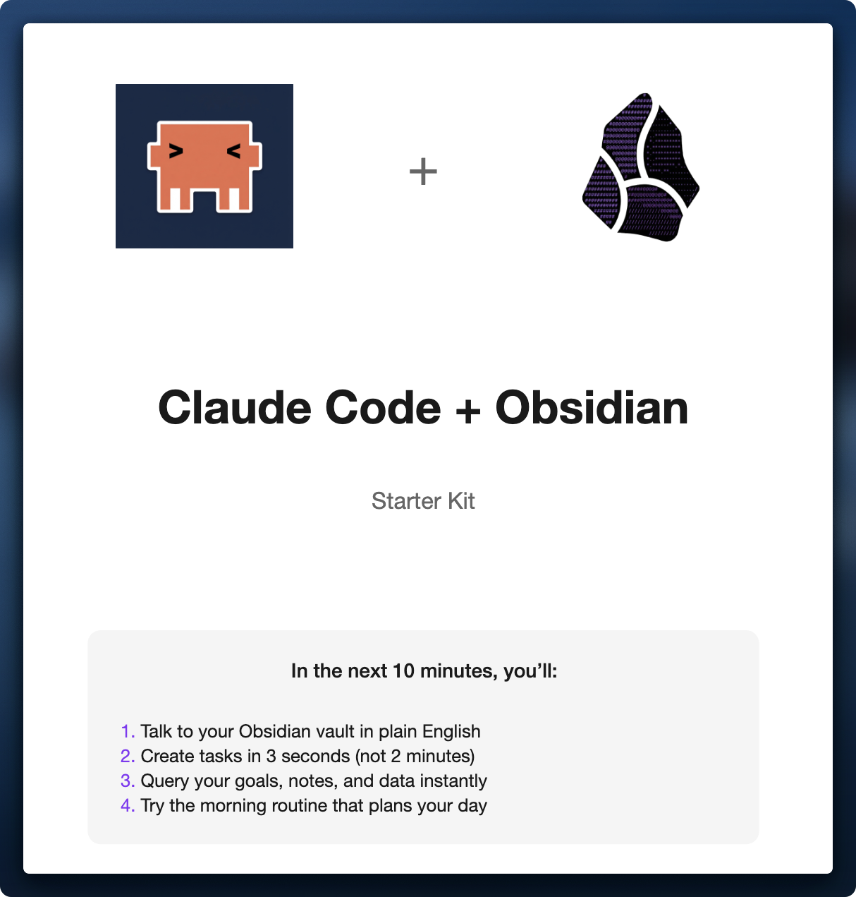
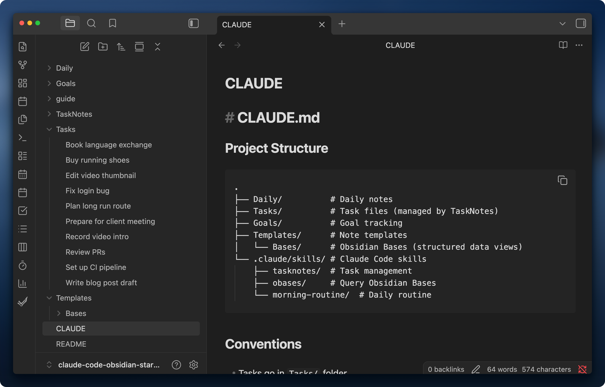

  

  📖 <strong><a href="guide/quick-start-guide.pdf">Full Guide (PDF)</a></strong> — Setup instructions with screenshots

> 📚 **Take control over your life. Point B, 14-day sprint on personal AI agents, starts Nov 3:** [lab.artemzhutov.com](https://lab.artemzhutov.com/)

---

## Quick Start

1. Clone: `git clone https://github.com/ArtemXTech/claude-code-obsidian-starter.git`
2. Open in Obsidian (trust plugins when prompted)
3. Run: `cd claude-code-obsidian-starter && claude`
4. Try: `/setup-memory` to build your CLAUDE.md

---

*The starter kit vault with CLAUDE.md open*

---

## What's Inside

| Skill | Does |
|-------|------|
| 🔍 query | Find projects, clients, tasks |
| ✅ tasknotes | Create & manage tasks |
| ☀️ review | Morning, evening, weekly routines |
| 👤 client | Client follow-ups & emails |

---

Made with ❤️ for the Obsidian community

By [Artem Zhutov](https://x.com/ArtemXTech)
